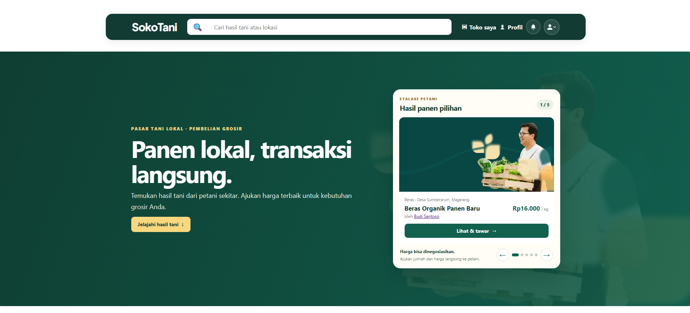
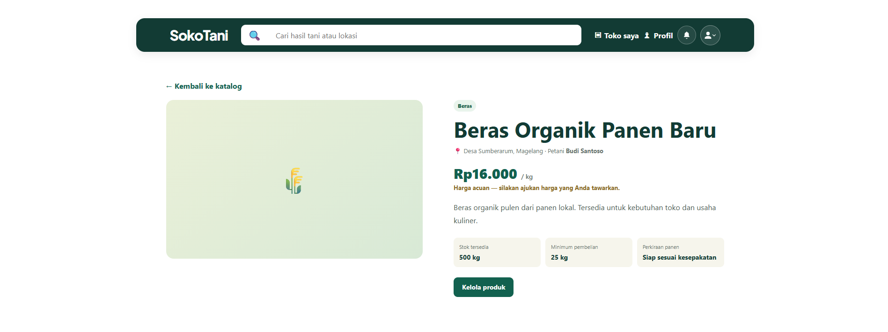
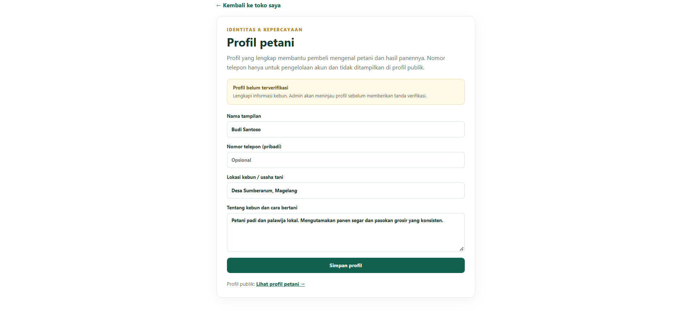

# SokoTani

SokoTani is a marketplace platform designed for agricultural transactions between farmers and buyers. The project focuses on wholesale ordering, price negotiation, and trust-building through farmer verification and profile transparency.

## Project overview

This app allows:

- farmers to publish product listings and manage availability
- buyers to browse products and submit offers
- both sides to negotiate prices and finalize bulk orders
- admins to verify trusted farmer profiles
- users to receive in-app notifications for offer updates

## Key features

- Farmer profile pages with public location and farm description
- Product catalog with search and category browsing
- Offer negotiation flow for buyer and farmer responses
- Verified farmer badges for trust and credibility
- Notification center for market activity
- Role-based access for buyer, farmer, and admin flows

## Demo accounts

Seeded demo accounts are available for local testing.

```text
Password: SokoTaniDemo!2026
```

- Farmer: `farmer.budi@sokotani.test`
- Farmer: `farmer.sari@sokotani.test`
- Farmer: `farmer.joko@sokotani.test`
- Buyer: `buyer.maya@sokotani.test`
- Buyer: `buyer.andi@sokotani.test`
- Buyer: `buyer.rina@sokotani.test`
- Admin: `admin@sokotani.test`

## Local setup

```bash
cp .env.example .env
php artisan key:generate
php artisan migrate
php artisan db:seed --class="Database\\Seeders\\DemoMarketplaceSeeder"
php artisan serve
```

Then open:

```text
http://localhost:8000
```

## Admin workflow

To promote an existing account to admin:

```bash
php artisan sokotani:make-admin admin@sokotani.test
```

This command asks for the user’s current password before updating their role.

## Project screenshots







## Testing

```bash
php artisan test
```

## License

This project is licensed under the MIT License.

